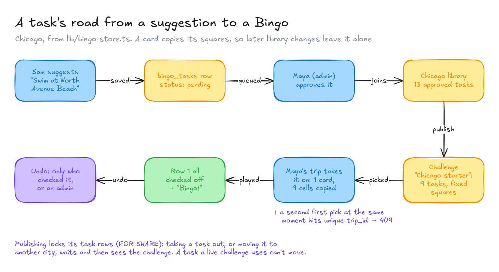

# Travel Bingo

Each city has a library of things to do there. Admins publish **challenges**: a city's tasks placed at fixed
squares of a 3×3, 4×4 or 5×5 card. A trip takes one challenge on, and its members check squares off as they do
them. A full row, column or diagonal is a Bingo. Anyone can suggest a task, and it joins the library once an admin
approves it.

| Where | What |
|---|---|
| `lib/bingo.ts` | The rules, as pure functions: finished lines, line names, place matching, input parsing (tested in `lib/bingo.test.ts`) |
| `lib/bingo-store.ts` | The library, the review queue, challenges and cards (tested in `lib/bingo-store.test.ts`) |
| `lib/bingo-catalog.ts` | The starter tasks the app ships with |
| `lib/bingo-types.ts` | `BingoTask`, `BingoChallenge`, `BingoCard`, `BingoCell`, `BingoRegion` |
| `app/trips/[id]/bingo` | A trip's card |
| `app/trips/bingo/{tasks,review,challenges}` | The library, the review queue and publishing, for admins |

## How it works

### A library per city, filled by review

A task is a row in `bingo_tasks` with a region (a city, e.g. "Chicago") and a status: `pending`, `approved` or
`rejected`. A member's suggestion starts as `pending` and goes into the review queue. An admin's addition is
`approved` straight away.

- **A region is a real city.** The form takes it from the place field (`components/PlaceField.tsx`), and the
  store refuses one the gazetteer doesn't know. A city the library already has under another spelling joins
  it ("Chicago, Illinois" joins "Chicago"); a new one is stored under its full name.
- **One spelling per city.** A region typed another way joins the existing one: "chicago, il" becomes
  "Chicago" (`canonicalRegion`). The comparison lowercases the name, removes punctuation, and drops a trailing
  real US state code or state name. Only a real code is dropped, so "Big Sky" stays "Big Sky" and isn't read as
  "Big Sur". This plain-text matcher still places a trip's destination in a region; the gazetteer
  (`lib/places.ts`, server-only) only checks the region when a task is saved.
- **No duplicates.** A partial unique index on `(region, lower(title))` covers every task that isn't rejected.
  `submitTask` checks first so it can say whether the duplicate is approved or still waiting; the index stops two
  people sending the same task in at the same moment.
- **Taking a task out doesn't delete it.** `removeTask` marks it rejected (its sender sees the reason) and
  withdraws every challenge that uses it. Cards already playing it keep the square, because cells point at task
  rows and those rows stay.

### Challenges are published, not drawn

A challenge is a title, a size, and one approved task of its region per square, in position order (row by row
from 0). An admin publishes it from `/trips/bingo/challenges`. Withdrawing it only sets `withdrawn_at`, so cards
already playing it are unaffected. On first use, each starter region gets a "starter" challenge made of its first
nine tasks. An advisory lock makes sure two server processes don't both seed it.

Publishing and changing the library can race, so `publishChallenge` runs in one transaction that first locks the
chosen task rows with `FOR SHARE`:

- If an admin takes one of those tasks out, or moves it to another city, at the same moment, that write waits
  for the publish to commit. It then sees the new challenge, so `removeTask` withdraws it and `editTask` refuses
  the move.
- If the removal or the move commits first, the publish finds the row no longer approved in that city and
  answers `400`.
- A task used by a challenge on offer can't move to another city (`409`). Moving it would leave a challenge that
  mixes two cities.

### A trip plays one card

Taking a challenge on creates the trip's `bingo_cards` row (unique per trip) and copies the challenge's squares
into `bingo_cells`. Because the squares are copied, a challenge withdrawn later, or a task reworded later,
leaves the card's layout as it is. A reworded task's new wording does show on the card, since cells point at the
task row.

- **Picking the first challenge.** Any member may. If two members pick at the same moment, there is no card row
  to lock yet, so the unique `trip_id` refuses the second with `409`.
- **Switching.** Only the organizer or an admin may, since it clears every square. It locks the current card
  (`FOR UPDATE`), deletes it (the cells go with it), and inserts the new one.
- **Checking a square off.** This is a conditional update (`where completed_at is null`): if two people check
  the same square at once, the first one wins and the second changes nothing.
- **Undo.** Only the member who checked the square, or an admin, may undo it. The write only goes through if the
  check is still the one that was read, so an undo never wipes a check someone else made in between (`409`).
- **Lines are computed, not stored.** `finishedLines` in `lib/bingo.ts` derives them from which squares are done.
  The page compares the lines before and after a click to announce "Bingo!".

The trip's page suggests the challenges of the city its destination names (`regionFor`). "Chicago, IL" names
Chicago, and when several regions match, the longest name wins.

## API

All routes answer `401` when logged out. Errors are `{ error }`.

| Method | Path | Body | Success | Errors |
|---|---|---|---|---|
| GET | `/api/trips/:id/bingo` | none | `200 { card, challenges, suggestedRegion, viewer: { id, admin, maySwitch } }`; `card` is `null` before the trip picks a challenge | `404` trip |
| POST | `/api/trips/:id/bingo` | `{ challengeId }` | `201 { card }`, every square unchecked | `400`; `403` switching when not the organizer or an admin; `404` trip, or challenge not on offer; `409` another member picked first at the same moment |
| PATCH | `/api/trips/:id/bingo/cells/:cellId` | `{ action: "complete" \| "undo" }` | `200 { card }` | `400`; `403` undoing someone else's square; `404`; `409` the square changed since it was read |
| GET | `/api/bingo/challenges?region=` | none | `200 { challenges }`, the ones on offer, newest first | none |
| POST | `/api/bingo/challenges` | `{ region, title, description?, size, taskIds }` | `201 { challenge }` | `400` invalid, or a task not approved in that region; `403` not an admin |
| DELETE | `/api/bingo/challenges/:challengeId` | none | `204`; taken off offer, cards keep playing it | `403`; `404` not on offer |
| GET | `/api/bingo/tasks?region=` | none | `200 { regions, tasks, mine, isAdmin, pendingCount }` | none |
| POST | `/api/bingo/tasks` | `{ region, title, description }` | `201 { task }`, pending, or approved at once for an admin | `400`; `409` the city already has it, or it's waiting |
| PATCH | `/api/bingo/tasks/:taskId` | `{ region, title, description }` | `200 { task }` | `400`; `403`; `404` not in the library; `409` the title is taken, or a challenge on offer uses it and the city changed |
| DELETE | `/api/bingo/tasks/:taskId` | none | `204`; its challenges are withdrawn | `403`; `404` |
| GET | `/api/bingo/review` | none | `200 { tasks }`, waiting, oldest first | `403` |
| PATCH | `/api/bingo/review/:taskId` | `{ action: "approve" \| "reject", note? }` | `200 { task }` | `400`; `403`; `404`; `409` already reviewed |

Notes on the shapes:

- `taskIds` holds `size²` distinct ids, one per square in position order.
- `GET /api/bingo/tasks` returns every region, the approved tasks of `region` (an empty list without it),
  everything I sent in, and, for an admin, how many tasks are waiting for review.
- A card's `cells` come in position order. `completed` counts the squares done, and `lines` lists each finished
  line as its positions, so `lines.length` is the number of Bingos.
- `viewer.maySwitch` and each cell's `completedById` tell the page where to offer Switch and Undo.
