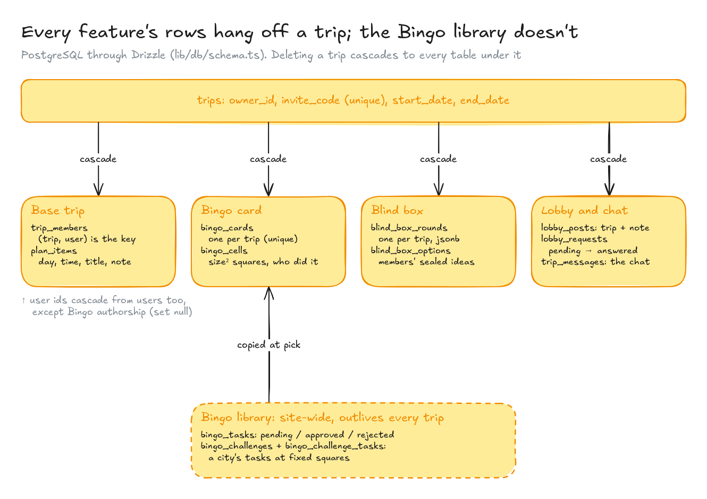

# Backend and database

Every feature keeps its data in one PostgreSQL database, read and written through Drizzle ORM, with accounts
and sessions through Better Auth. The route handlers in `app/api/` are the only way in: the frontend calls them
through `lib/api.ts` and nothing else. This doc covers running the database, the tables, the conventions every
endpoint follows, and the API of the base features (accounts, trips, members, itinerary). Each feature's own API
is in its doc: [bingo.md](bingo.md), [lottery-box.md](lottery-box.md), [lobby.md](lobby.md). Who may call what is in
[roles.md](roles.md).

## Running it

PostgreSQL 18 runs locally in Apple's `container` CLI. Set it up once; the data stays in the `triptogether-pg`
volume. Also create the database the tests use:

```sh
container volume create triptogether-pg
container run -d --name triptogether-pg -p 127.0.0.1:5432:5432 -v triptogether-pg:/var/lib/postgresql \
  -e POSTGRES_USER=triptogether -e POSTGRES_PASSWORD=triptogether -e POSTGRES_DB=triptogether \
  docker.io/library/postgres:18
container exec triptogether-pg psql -U triptogether -c "create database triptogether_test"
```

After a reboot, run `container system start` and then `container start triptogether-pg`. To use Docker instead,
`docker compose up -d` starts the same server from `docker-compose.yml`. Create `triptogether_test` the same way,
with `docker compose exec db psql …`.

Put the settings in `.env.local` and run `npm run dev`. The app applies any pending migrations on the first
request.

| Setting | What it does | Default |
|---|---|---|
| `DATABASE_URL` | The PostgreSQL server, `postgres://…` | none; required |
| `BETTER_AUTH_SECRET` | Signs the session cookie (`openssl rand -base64 32`) | Better Auth's dev-only secret, with a warning |
| `BETTER_AUTH_URL` | The address the app is served from | `http://localhost:3000` |
| `ADMIN_EMAILS` | Comma-separated emails of the Bingo admins ([roles.md](roles.md)) | nobody |

There is deliberately no in-process stand-in such as PGlite. Without `DATABASE_URL`, the first request fails with
a message pointing here.

## The tables



Every table is defined in `lib/db/schema.ts`. After changing it, run `npm run db:generate` and commit the new
migration in `drizzle/`. The rule that shapes the schema is that **a trip owns its features' rows**: each feature
table has a `trip_id` with `on delete cascade`, so deleting a trip deletes everything under it, with no clean-up
code. User ids cascade the same way from `users`, with one exception: Bingo authorship columns are set to null,
because a task or challenge someone wrote stays useful after they delete their account.

| Group | Tables | Constraints that carry a rule |
|---|---|---|
| Accounts (Better Auth) | `users`, `sessions`, `accounts`, `verifications` | `users.email` is unique; `accounts.password` holds the hash |
| Base trip | `trips`, `trip_members`, `plan_items` | `trips.invite_code` is unique; `(trip_id, user_id)` is the primary key of `trip_members`, so joining twice does nothing |
| Bingo library | `bingo_tasks`, `bingo_challenges`, `bingo_challenge_tasks` | one live task per region and title, ignoring case (a partial unique index that skips rejected tasks) |
| Bingo card | `bingo_cards`, `bingo_cells` | `bingo_cards.trip_id` is unique, so a trip has one card; `(card_id, position)` is unique |
| Lottery box | `blind_box_rounds`, `blind_box_options` | `blind_box_rounds.trip_id` is unique, so a trip has one current round |
| Lobby and chat | `lobby_posts`, `lobby_requests`, `trip_messages` | `lobby_posts.trip_id` is unique; one pending request per person and trip (a partial unique index) |

Wherever two people could race, a unique constraint or a row lock settles it. The application checks first so it
can return a friendly message, and the constraint is what keeps the data correct. Each feature doc says which
locks it takes.

Three things about the connection (`lib/db/client.ts`):

- The pool opens on the first query, not on import. That way `next build` and the worker processes of `next dev`
  never need a database.
- The pool lives on `globalThis`, so a hot reload reuses it instead of opening another one.
- `ready()` runs the migrations once per process. Every store function awaits it before its first query.

`trips.name`, `trips.budget` and `plan_items.sort_order` come from the proposal but no endpoint uses them yet.
They are in the schema already so that adding them later needs no migration.

## Conventions every endpoint follows

- Bodies are JSON. The shapes are in `lib/types.ts`, `lib/bingo-types.ts` and `lib/lottery-box-types.ts`.
- Dates are `YYYY-MM-DD` strings with no time or time zone. Date maths is done in UTC (`lib/dates.ts`), so a
  date never shifts by a day depending on where the reader is.
- Every error is `{ "error": string }`, written for the person using the app. The frontend shows it as is.
- The session is Better Auth's signed, httpOnly cookie `better-auth.session_token`. Every endpoint outside
  `/api/auth` returns `401` without it.
- A trip you aren't a member of answers `404`, the same as a trip that doesn't exist, so trip ids can't be
  probed.
- Input goes through one parser per shape (`lib/validate.ts`, `lib/bingo.ts`, `lib/lottery-box.ts`). Each parser
  drops unknown fields, so a body can't set `ownerId`, `inviteCode` or `addedBy`.

## Base features API

Better Auth's own endpoints are not mounted. The routes under `app/api/auth` call `auth.api.*` (`lib/auth.ts`),
so this contract stays the way the frontend was written against it.

| Method | Path | Body | Success | Errors |
|---|---|---|---|---|
| POST | `/api/auth/register` | `{ name, email, password }` | `201 { user }`, sets the cookie | `400` missing name, bad email, password under 8 characters; `409` email taken |
| POST | `/api/auth/login` | `{ email, password }` | `200 { user }`, sets the cookie | `401` wrong email or password |
| POST | `/api/auth/logout` | none | `204`, clears the cookie | none |
| GET | `/api/auth/me` | none | `200 { user }` | `401` |
| GET | `/api/trips` | none | `200 { trips }`, the ones I'm in, earliest start first | `401` |
| POST | `/api/trips` | `TripInput` | `201 { trip }`; I become its organizer and first member | `400` |
| GET | `/api/trips/:id` | none | `200 { trip, members, items }` | `404` |
| PATCH | `/api/trips/:id` | `TripInput` (all four fields) | `200 { trip }` | `400`; `403` not the organizer; `404` |
| DELETE | `/api/trips/:id` | none | `204`; everything under the trip goes too | `403` not the organizer; `404` |
| POST | `/api/trips/join` | `{ code }` | `200 { trip }`; joining a trip I'm already in also succeeds | `404` no trip has that code |
| DELETE | `/api/trips/:id/members/me` | none | `204`, I leave | `404`; `409` the organizer can't leave (delete the trip instead) |
| POST | `/api/trips/:id/items` | `PlanInput` | `201 { item }`; `addedBy` is my name | `400`; `404` |
| PATCH | `/api/trips/:id/items/:itemId` | `PlanInput` (all fields) | `200 { item }` | `400`; `404` trip or item |
| DELETE | `/api/trips/:id/items/:itemId` | none | `204` | `404` trip or item |

- Emails are trimmed and lowercased before they're stored or compared.
- `TripInput` is `{ origin, destination, startDate, endDate }`. Both places have to be ones the gazetteer knows
  (`lib/places.ts`, cities of 15,000 people and up); anything else is a `400`. They are stored under their full
  names, "Chicago, Illinois", whatever spelling was sent. The forms use `components/PlaceField.tsx`, which
  only accepts a place picked from `/api/places`. Trips saved before this keep the names they were typed with
  until they are edited.
- The end may equal the start but not come before
  it, and a trip is at most 60 days.
- An invite code is 6 characters from `ABCDEFGHJKMNPQRSTUVWXYZ23456789`, with no 0/O or 1/I/L so it survives
  being read aloud. If two trips draw the same code, the unique index refuses the second and `createTrip` draws
  again. The join endpoint trims and uppercases the code before looking it up.
- `PlanInput` is `{ date, time, title, place, note }`.
  - `date` is a day within the trip.
  - `time` is `HH:MM`, or empty for "any time that day" (stored as `null`).
  - `title` is required, up to 120 characters; `place` is up to 120 and `note` up to 1000.
- Any member may add, edit or remove any plan item. Items come back in no particular order. `lib/itinerary.ts`
  groups them into the trip's days: "any time" items first, then by time.
- Moving the trip's dates leaves its items where they are, even outside the new dates. The page shows those days
  apart, so a member can move or remove them.

## Tests

`npm test` runs the pure tests and the store tests. The store tests use the `triptogether_test` database on the
same server; override it with `TEST_DATABASE_URL`, which must name a `*_test` database. Each store test file
empties that database and applies the migrations afresh (`lib/db/test-db.ts`), which is why the files run one at
a time.
