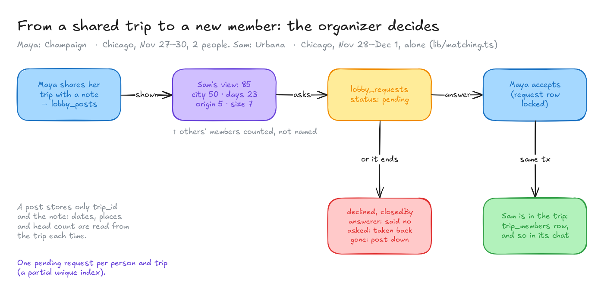

# Shared lobby and chat

A trip's organizer can share the trip in the lobby with a short note. Everyone else sees the shared trips
compared with their own trips, best match first, and can ask to join one. When the organizer accepts, the person
who asked becomes a member of the trip and so joins its chat group. Every trip has a chat, whether or not it's in
the lobby.

| Where | What |
|---|---|
| `lib/lobby-store.ts` | Posts, requests, the pending count, and each trip's chat (tested in `lib/lobby-store.test.ts`) |
| `lib/matching.ts` | How close two trips are, and why, as pure functions (tested in `lib/matching.test.ts`) |
| `lib/lobby.ts` | Search, date filters and sort order, pure (tested in `lib/lobby.test.ts`) |
| `lib/places.ts`, `lib/places.json.gz`, `lib/place-search.ts` | The GeoNames gazetteer and the place search, server only |
| `app/trips/lobby`, `app/trips/[id]/chat`, `components/lobby/**`, `components/TripNav.tsx` | The pages and the nav badge |

## How it works

### A post points at the trip

A row in `lobby_posts` stores only the `trip_id` (unique, so a trip is in the lobby at most once) and the
organizer's note. Where the trip goes, its dates and its head count are read from the trip each time the lobby
loads, so a post never shows an outdated plan. Only the organizer can share a trip or take it down, and a trip
that has already ended can't be shared.

On another group's card, the members are counted but not named; the names are replaced with placeholders before
the response leaves the server. Your own trips list their members by name.

### Matching: how close another trip is

`similarity` in `lib/matching.ts` scores another trip against one of yours, out of 100, and gives the reasons in
plain words:

| Part | Points | How |
|---|---|---|
| Destination | 50 | Same place 50; a nearby place (within 60 km) 38; same region (within 250 km) 20; otherwise 0 |
| Dates | 30 | The share of the shorter trip's days that the two trips have in common |
| Origin | 10 | Same place 10; nearby or same region 5 |
| Group size | 10 | Same head count 10; then 7, 4 and 2 as the gap grows |

Two trips with no days in common score 0, since travelling together means travelling at the same time.
Two trips to different places can't be done together, so their score is capped at 30. Two trips to the same
region but different cities are capped at 35. Both caps stay under 40, the "Possible match" line; 60 and above
is a "Great match".

In the diagram, Sam's Urbana → Chicago trip scores 85 against Maya's Champaign → Chicago trip:

- same city: 50
- 3 of his 4 days shared: 23
- a nearby origin: 5
- a head count one apart: 7

Places are compared as real places, not as strings. Both names are looked up in the gazetteer, so "北京" and
"Beijing" are one city, "Chicago" and "Chicago, IL" are one city, and two different cities are compared by the
real distance between them. A name the gazetteer doesn't know is compared as text.

Without `?against=`, each shared trip is compared with whichever of your trips matches it best. The lobby then
sorts: trips that have already ended go last, then trips whose dates clash with yours, then by score, then by
start date. The search matches destinations by any of their names (and by country or region), origins, and notes.

### A request, and who answers it

A request is a row in `lobby_requests` that starts as `pending`. It stores the score at the time of asking, which
orders the organizer's list.

- **One open request per person and trip.** This is a partial unique index on pending rows. You can ask again
  after a request has ended.
- **Only the organizer answers.** Accepting locks the request row (`FOR UPDATE`), inserts the `trip_members` row
  and marks the request accepted, all in one transaction. A withdrawal or a second answer at the same moment
  waits, then finds the request already answered (`409`). Someone who joined with the invite code in the
  meantime simply stays in.
- **Every ending is kept.** A request ends `accepted`, or `declined` with `closedBy` saying why: `answerer` (the
  organizer said no), `asked` (the applicant took it back) or `gone` (the organizer took the post down, which
  closes every pending request). An accepted request stays accepted if the person later leaves the trip.

Every member sees the requests about their trip, with the applicant's name and message. The person who asked sees
their own.

### The pending badge

The nav shows how many requests are waiting for your answer. It polls `GET /api/join-requests` every five
seconds and again when the window regains focus. That endpoint runs a single count query (pending requests on
trips you organize); it doesn't build the whole lobby. When you answer a request on the lobby page, the page sends
the new count straight to the nav (a `lobby:pending` event), so the badge updates without waiting for the next
poll.

### The chat

`trip_messages` holds a trip's chat. Only members can read and write it, through the usual membership check.
The chat page polls every three seconds and merges what comes back by message id, so a poll that started before
you pressed Send can't make your message disappear.

## API

All routes answer `401` when logged out.

| Method | Path | Body | Success | Errors |
|---|---|---|---|---|
| GET | `/api/lobby` | none | `200 LobbyView` | `400` bad dates |
| POST | `/api/lobby` | `{ tripId, note }` | `201 { post }` | `400`; `403` not the organizer; `404` not my trip; `409` already shared, or the trip is over |
| DELETE | `/api/lobby/:tripId` | none | `204`; pending requests close with `closedBy: "gone"` | `403`; `404` not my trip, or not shared |
| GET | `/api/join-requests` | none | `200 { pendingRequestCount }`, the requests waiting for my answer | none |
| POST | `/api/join-requests` | `{ postId, message? }` | `201 { request }` | `400`; `404` not in the lobby; `409` already in it, it's over, or I'm already waiting |
| GET | `/api/join-requests/:id` | none | `200 { request }` | `404` unless I asked or am in the trip |
| PATCH | `/api/join-requests/:id` | `{ action: "accept" \| "decline" \| "withdraw" }` | `200 { request }` | `400`; `403` only the organizer answers, nobody answers their own request, only the applicant withdraws; `404`; `409` already answered, or the trip is over |
| GET | `/api/trips/:id/chat` | none | `200 { messages }`, oldest first | `404` not a member |
| POST | `/api/trips/:id/chat` | `{ body }`, 1 to 2000 characters | `201 { message }` | `400`; `404` |
| GET | `/api/places?q=` | none | `200 { places }`, up to 8 suggestions | none |

### Query parameters for `GET /api/lobby`

| Parameter | Meaning |
|---|---|
| `?against=<tripId>` | Which of my trips the others are compared with |
| `?q=` | A search |
| `?from=` / `?to=` | `YYYY-MM-DD`: trips travelled within that window |
| `?sort=` | `closest` (the default), `soonest` or `soonest-end` |

### What `LobbyView` holds

`LobbyView` is `{ mine, others, requests, pendingRequestCount, publishedTripIds }`:

- **`mine` and `others`** are posts. Each one has its trip's details plus:
  - `score` and `reasons`
  - `datesClash` and `ended`
  - `members`, counted only, on others' cards
  - `basis`: which of my trips it was compared with, and the days in common
  - `myRequest`: my latest request about it
- **`requests`** are `{ request, role, mayAnswer, trip, members, gone }`:
  - `role` is `member` or `applicant`.
  - `mayAnswer` is true only for the organizer, while the request is pending.
  - `gone` means the post has come down.
- **`publishedTripIds`** lists my trips that are in the lobby, whatever the filters.

A `JoinRequest` is `{ id, tripId, applicantId, applicantName, message, status, score, createdAt, respondedAt,
closedBy }`. A `ChatMessage` is `{ id, tripId, senderId, senderName, body, sentAt }`.

### Place suggestions

A place suggestion is `{ name, country, region, weight }`. The gazetteer is far too big to send to a browser, so
the search runs on the server.
