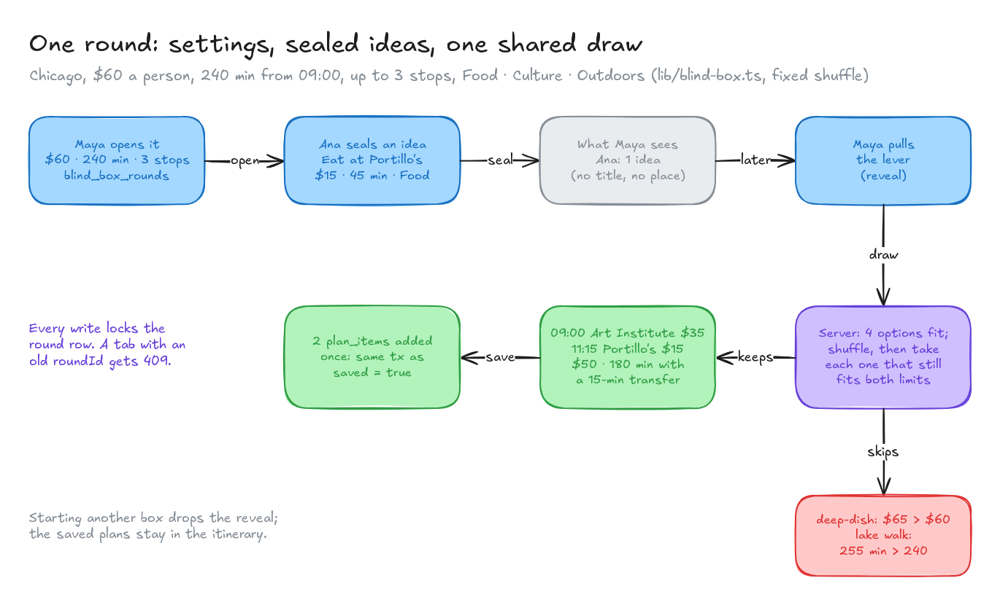

# Travel lottery box

The organizer sets the limits for a surprise outing: a day and start time, a budget per person, the time
available, how many stops, and the kinds of activity. Each member seals ideas into the box without anyone else
seeing them. When the organizer pulls the lever, the server draws one route for the whole group from the sealed
ideas and some demo suggestions, everyone sees the same result, and any member can add it to the itinerary in
one click.

| Where | What |
|---|---|
| `lib/lottery-box.ts` | The rules, as pure functions: parsing the settings and ideas, which options fit, the draw (tested in `lib/lottery-box.test.ts`) |
| `lib/lottery-box-store.ts` | Rounds and sealed ideas; every write locks the round row (tested in `lib/lottery-box-store.test.ts`) |
| `lib/lottery-box-catalog.ts` | Demo ideas for Chicago, New York and San Francisco |
| `lib/lottery-box-types.ts` | `LotteryBoxSettings`, `LotteryBoxOptionInput`, `LotteryBoxResult`, `LotteryBoxView` |
| `app/trips/[id]/lottery-box`, `components/LotteryBox*.tsx` | The page, the forms, and the slot-machine reveal |

## How it works

### One round per trip

A trip has at most one current round, a row in `blind_box_rounds` (`trip_id` is unique). The settings and the
drawn result are stored as `jsonb`, because they are always read and written whole. The members' ideas are rows
in `blind_box_options`. A round is either **collecting** (no result yet) or **revealed**.

- Only the organizer starts, reveals or resets a box. Any member seals ideas, removes their own, and saves the
  result.
- Starting another box after a reveal deletes the old round and its ideas, but plans already saved stay in the
  itinerary. While a round is still collecting, the organizer has to reset it first.

### Sealed means sealed

Before the reveal, `GET` returns a person's own ideas (`ownOptions`) and only a count for everyone else
(`submissions`). The organizer can't see others' ideas either. After the reveal, `revealedOptions` lists every
current member's ideas, the drawn ones and the rest. Ideas from someone who has left the trip stay out of the
draw and out of the reveal.

An idea is checked against the round's settings when it is sealed. One that couldn't fit (a category not chosen,
or a cost over the budget) is refused right away, instead of being silently skipped at the draw. Each person may
seal up to 10 ideas per round.

### The draw

`drawLotteryBox` takes every option that fits: the right city (demo ideas are matched by name, members' ideas take
the round's destination), a chosen category, a cost within the budget, and a duration within the time available.
It shuffles them (Fisher–Yates with `crypto.randomInt`), then walks the list and keeps each option that still
fits both limits, counting a 15-minute transfer between stops, until it has `maxStops`.

In the diagram's example, four options fit. The art museum ($35, 120 min) goes first, at 09:00. Deep-dish next
would bring the total to $65, over $60, so it's skipped. Portillo's ($15, 45 min) fits at 11:15. The lake walk
would bring the time to 255 minutes, over 240, so it's skipped too. The result is two stops, $50 and 180 minutes.
Because the walk is greedy, the draw can return fewer stops than asked for. If nothing fits, the box stays
sealed and the organizer sees why.

### Concurrency

Every write runs in a transaction that first locks the trip's round row (`withRound`), so writes to one box
happen one at a time:

- **Two saves at once.** The second save waits, then finds `saved = true` and does nothing. The stops are
  inserted into `plan_items` in the same transaction that sets `saved`, so they land once or not at all.
- **A reveal clicked twice.** The second one finds the result already there and returns it.
- **A stale tab.** Every write carries the `roundId` it was looking at. A tab still showing a round that has been
  reset or replaced gets `409` instead of changing the new one.
- **Two first rounds started at once.** There is no row to lock yet, so the unique `trip_id` refuses the second.

The page polls every five seconds, so other members see new counts and the reveal without reloading.

## API

`/api/trips/:id/lottery-box` checks the session and membership like every trip route (`401` / `404`). Every success
returns `{ box: LotteryBoxView | null }` with `Cache-Control: private, no-store`.

| Method | Body | Success | Errors |
|---|---|---|---|
| GET | none | `200`, `null` when there is no round | none |
| POST | `LotteryBoxSettings`, plus `previousRoundId` when replacing a revealed round | `201`, a new collecting round | `400` invalid settings; `403` not the organizer; `409` a round is collecting, or the round changed |
| PATCH | `{ roundId, action: "submit", option }` | `200`, the idea is sealed | `400` invalid, doesn't fit, or more than 10; `409` stale or revealed round |
| PATCH | `{ roundId, action: "remove", optionId }` | `200`, my idea is removed | `404` not mine; `409` stale or revealed round |
| PATCH | `{ roundId, action: "reveal" }` | `200`, the shared result (a repeat returns the same one) | `400` nothing fits, or the day is now outside the trip; `403`; `409` stale round |
| PATCH | `{ roundId, action: "save" }` | `200`, the stops are in the itinerary once, `saved: true` | `400` the day is now outside the trip; `409` stale or not yet revealed |
| DELETE | `{ roundId }` | `200 { box: null }`, the round is reset | `403`; `409` stale round |

- **Settings** are `{ destination, date, startTime, budget, availableMinutes, maxStops, preferences }`:
  - `destination`: up to 120 characters.
  - `date`: a day within the trip. `startTime`: `HH:MM`.
  - `budget`: activity cost per person in USD, from 0 to 10,000, with up to two decimals. Transport isn't
    included.
  - `availableMinutes`: 15 to 720, and the time window must end by midnight. `maxStops`: 1 to 5.
  - `preferences`: at least one of `Sightseeing`, `Food`, `Outdoors`, `Culture`, `Adventure`, `Relaxation`.
- **An idea** is `{ title, place, category, cost, durationMinutes, note }`. Title and place are required, up to
  120 characters each, and the note is up to 500. Cost has the same bounds as the budget, and the duration is 15
  to 720 minutes. The server fills in who sent it and the destination.

## Checking it by hand

1. As the organizer, create a trip to Chicago and open the lottery box. Set $60, 240 minutes, 3 stops, and a few
   preferences.
2. In a private window, register a second traveler, join with the invite code, and seal a matching idea. Within
   five seconds, the organizer's view should show the count go up but not the idea itself.
3. Pull the lever. Both windows should show the same route, within $60 and 240 minutes including the transfers.
4. Add the stops to the itinerary from both windows. They should appear once.
5. Try a city without demo ideas, such as Urbana: it should work with members' ideas alone.
6. Turn on Reduce motion. The reveal should appear without spinning reels.
