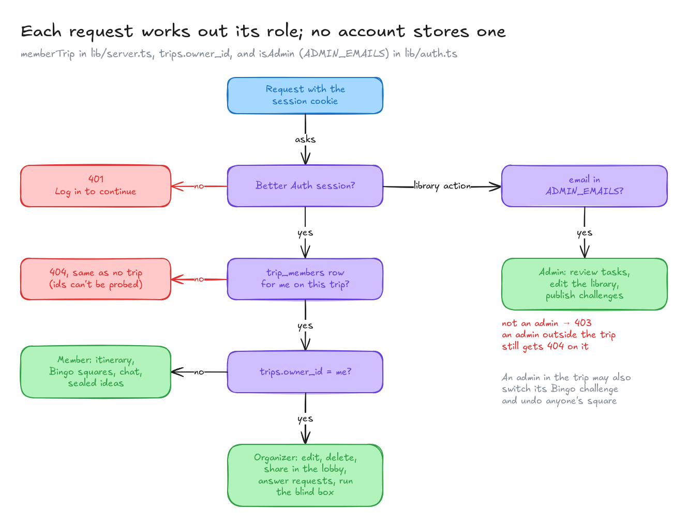

# Roles and permissions

TripTogether has one kind of account. What a person may do depends on two things, and both are worked out on
each request rather than stored on the account:

- **Organizer or member**, per trip. Whoever creates a trip is its organizer; whoever joins it is a member. The
  same person can organize one trip and be a member of another.
- **Admin**, site-wide. These are the accounts whose email is listed in `ADMIN_EMAILS`. Admins look after the
  Bingo task library.

The two are independent. An admin can't edit, delete or manage someone else's trip, and an organizer has no
extra say over the task library. There is one overlap, a trip's Bingo card, covered below.

## How a request's role is decided

| Role | Where it lives | How it's decided |
|---|---|---|
| Account | `users` table | Everyone alike: a name and an email. There is no role column. |
| Member of a trip | `trip_members` | You have a row for the trip. The organizer has one too. |
| Organizer of a trip | `trips.owner_id` | The trip's `owner_id` is you. It is set when you create the trip and never changes. |
| Admin | `ADMIN_EMAILS` in `.env.local`, not the database | Your email is in the comma-separated list (`isAdmin` in `lib/auth.ts`). Restart the server after changing it. |

Every trip route starts with `memberTrip` (`lib/server.ts`). It returns `401` without a session, and `404` when
the trip doesn't exist or you aren't in it, so the two cases look the same and trip ids can't be probed. Only
after that does a route compare `trip.ownerId` with you for organizer-only actions (`403`). The admin check is
separate (`currentAdmin` in `lib/bingo-api.ts`) and applies only to the site-wide Bingo library.

The design choices behind this:

- **No role column.** Organizer is a property of a trip, not of a person, so it lives on the trip. A single
  global role couldn't express "organizer here, member there".
- **Admins live in the server's settings.** That way nobody can make themselves an admin through the app. If
  admins are ever appointed from inside the app, add a `role` column to `users` and change `isAdmin`.
- **The organizer can't leave.** A trip always has someone who can edit and delete it. The organizer deletes the
  trip instead.

## What each role may do

### Trips

| Action | Organizer | Member | Not in the trip |
|---|---|---|---|
| See the trip, its members and invite code | ✅ | ✅ | ❌ 404 (admins included) |
| Add, edit, delete itinerary items | ✅ | ✅ | ❌ |
| Edit the trip (origin, destination, dates) | ✅ | ❌ 403 | ❌ |
| Delete the trip | ✅ | ❌ 403 | ❌ |
| Leave the trip | ❌ 409, delete it instead | ✅ | none |
| Join with the invite code | none | none | ✅ |

### Travel Bingo card (per trip)

| Action | Admin in the trip | Organizer | Member |
|---|---|---|---|
| Pick the trip's first challenge | ✅ | ✅ | ✅ |
| Switch to another challenge (clears every square) | ✅ | ✅ | ❌ 403 |
| Check a square off | ✅ | ✅ | ✅ |
| Undo a square they checked off themselves | ✅ | ✅ | ✅ |
| Undo a square someone else checked off | ✅ | ❌ 403 | ❌ 403 |

An admin still has to be a member of the trip to see its card at all. Switching is limited to the organizer
because it wipes everyone's progress. Undo belongs to whoever checked the square, so one member can't erase
another's work.

### Bingo task library (site-wide)

| Action | Admin | Anyone else |
|---|---|---|
| Browse every region's tasks | ✅ | ✅ |
| Add a task | ✅ straight into the library | ✅ as a suggestion, waiting for review |
| Edit or take out a task in the library | ✅ | ❌ 403 |
| Publish or withdraw a challenge | ✅ | ❌ 403 |
| Approve or turn down suggestions | ✅ | ❌ 403 |
| See the "Admin: Bingo task library" line on the trips page | ✅ | hidden |

### Travel blind box (per trip)

| Action | Organizer | Member |
|---|---|---|
| Start, reset, or reveal the box | ✅ | ❌ 403 |
| Seal ideas into it, and remove their own | ✅ | ✅ |
| See another person's sealed ideas before the reveal | ❌ | ❌ |
| Add the revealed stops to the itinerary | ✅ | ✅ |

### Shared lobby and chat (per trip)

| Action | Organizer | Member | Not in the trip |
|---|---|---|---|
| Share the trip in the lobby, or take it out | ✅ | ❌ 403 | ❌ 404 |
| See requests to join, with the applicant's name and message | ✅ | ✅ | only their own |
| Accept or decline a request | ✅ | ❌ 403 | ❌ 404 |
| Ask to join | none | ❌ 409, already in | ✅ |
| Take back their own request | none | none | ✅ |
| Read and write in the trip's chat | ✅ | ✅ | ❌ 404 |

Admins have no extra powers in the lobby. On other groups' cards, members are counted, not named.

## The demo accounts

`sh scripts/seed.sh http://localhost:3000` creates Maya and Sam (password `roadtrip1`). With
`ADMIN_EMAILS=maya@example.com`, Maya is the admin.

| Account | Admin? | In Maya's Chicago trip | In their own trips |
|---|---|---|---|
| maya@example.com | ✅ | organizer | organizer (Nashville) |
| sam@example.com | ❌ | member (joined with the code) | organizer (Chicago from Urbana, Great Smoky Mountains) |

To show the roles in a demo:

1. **Organizer.** Log in as Sam and open his Great Smoky Mountains trip: he can edit and delete it.
2. **Member.** Still as Sam, open Maya's Chicago trip. There is no edit or delete. He can add to the itinerary
   and play Bingo, but "Switch challenge" isn't offered, and squares others checked off have no Undo.
3. **Suggesting a task.** On that Bingo page, Sam follows "Suggest a task" and sends one in. It shows as
   "Waiting for review".
4. **Admin.** Log in as Maya. The foot of the trips page reads "Admin: Bingo task library · 1 suggestion to
   review". She approves Sam's task, and can edit or take out any task in any region.
5. **Publishing a challenge.** Still as Maya, she opens "Bingo challenges", picks Chicago, fills the nine
   squares (Sam's task among them) and publishes it. Every group can now take it on.
